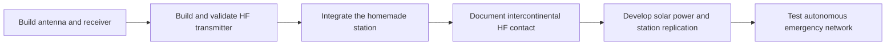

# Desktop Radio Lab

Build a homemade amateur radio station from components and documented circuits, achieve intercontinental HF contacts, then develop autonomous stations for communication during emergencies.

**Status:** project roadmap and a [priced proposal for a standalone HF voice build](docs/standalone-hf-bom.md). No hardware has been purchased, assembled or tested as part of this project. Existing equipment and operator qualifications still need to be inventoried.

## Goal

This is one progressive project: homemade construction, intercontinental HF operation, then autonomous emergency stations. The HF station is an intermediate milestone and the foundation for later work. See the [project path and DIY approach](docs/workstreams.md). Lunar reflection is parked at the owner's request.

Progress from the first locally received signal to documented amateur radio contacts using a station assembled and understood by its owner. Develop HF capability for distant contacts first. Then reuse the skills and suitable components to develop solar powered stations and a practical voice network. Add VHF/UHF or another appropriate service when the network design requires it.

The intermediate milestone is a documented intercontinental HF voice contact using the homemade station. The later milestone is an autonomous network tested for intelligible communication at defined locations and for an agreed period without external power. Schematics, assembly records and measurements must make the builds reproducible. Range depends on the installation and operating conditions; neither milestone has been achieved yet.

The [objectives](docs/objectives.md) and [roadmap](docs/roadmap.md) define this sequence. Future network stations may need different radios or antennas from the first HF station. Kits and purchased modules remain options to evaluate, not selected substitutes for the owner's construction objective.

An additional [RF geolocation experiment](docs/rf-geolocation.md) will investigate estimating a transmitting station's position from received radio waves. Start with reference transmitters and compare estimates with independently recorded locations. This scientific objective can progress alongside the station build; it is not a prerequisite for HF contacts or the emergency network.

The [budget comparison](docs/budget.md) retains commercial reference configurations and preliminary DIY allowances. Later network options include direct radios and a true unattended repeater; they provide different capabilities and have different operating requirements.

## Station concept

Build and validate the receive path before commissioning transmission. An optional purchased SDR can serve as a reference instrument. Frequency coverage does not imply simultaneous reception of every channel or support for every modulation. HF serves the distant contact milestone; select the later network's bands and topology for its actual coverage requirements. See the [technical references](docs/sources.md).

Before adding a transmitter, design receiver protection and antenna switching. Never connect transmitter output directly to an SDR input. A shared antenna needs properly rated switching and isolation.

## Buy and build

| Part | Starting approach | Evidence to keep |
| --- | --- | --- |
| Receiver | Build from a documented circuit or suitable modules; evaluate a reference SDR only when useful | Schematic, assembly, settings and first reception |
| Antenna | Build a simple antenna appropriate to available space and the first band | Dimensions, diagram, construction photos and comparison |
| Feed line and connectors | Buy suitable cable and connectors; assemble where practical | Cable type, length, continuity and losses when measured |
| Filters and attenuators | Build the band and output filters required by the selected circuit; add extra filters or attenuators only after measuring a specific need | Circuit, parts and measured frequency response |
| Desk controls | Build a tuning knob and controls using a purchased microcontroller | Wiring, firmware and demonstrated integration |
| Transmit station | Build the HF signal chain in verified stages using a documented design; evaluate a kit as one possible approach | Schematic, configuration, bench checks and contacts |
| Power and instruments | Assemble suitable low voltage power distribution from rated parts; obtain instruments as needed, then develop solar power in the later phase | Ratings, setup, energy measurements and limitations |

The [standalone HF bill of materials](docs/standalone-hf-bom.md) proposes a QMX kit, microphone and antenna assembly route, with verified product prices and explicit installation gaps. It does not authorize purchases or claim a fully original circuit design. Start physical validation with reception; commission the transmitter after the assembly checks.

## Build process

Follow the [roadmap](docs/roadmap.md) and record each experiment in the [build log](docs/build-log.md). For every meaningful iteration:

1. Define the capability or problem.
2. Draw the circuit or connection diagram and list the necessary parts.
3. Assemble, configure and explain how it works.
4. Measure the result against a baseline and record limitations.
5. Publish the evidence in a small, coherent commit before choosing the next improvement.

Store schematics, firmware and measurements when they exist. Clearly label simulation, remote reception, local reception and measured hardware results. Remote web receivers can support learning but do not validate this station's antenna.

## First practical step

Use the [standalone HF bill of materials](docs/standalone-hf-bom.md), checked on 2026-10-26, for the current purchase proposal. It covers voice operation without a PC, kit contents, external accessories, the antenna candidate, tools and commissioning dependencies. Initial firmware installation still needs a computer. The antenna site is tentatively a roof; span, cable routing and mounting remain unverified, so no final delivered total is claimed.

The [earlier product comparison](docs/product-price-check.md) and [step 1 feasibility study](docs/step-1-feasibility.md) remain historical context. Their receiver alternatives, supplies and tool baskets must not be added to the current proposal. Suitable RF measurement access remains unconfirmed rather than assumed free.

Record roof dimensions, available tools, electronics experience and licensing status. Confirm the antenna installation before ordering site-dependent items. The first physical milestone is repeatable reception through the station's own antenna; subsequent bench tests and authorized contacts establish transmitter performance.

## Operating context

The initial phase is receive only, focused on amateur and broadcast signals. Before amateur transmission in Italy, verify the operator's licence, callsign and general authorization with the [MIMIT](https://ispettorati.mise.gov.it/index.php/servizi/radioamatori/), together with the applicable bands and operating limits. Being able to tune a frequency does not authorize transmitting on it.
