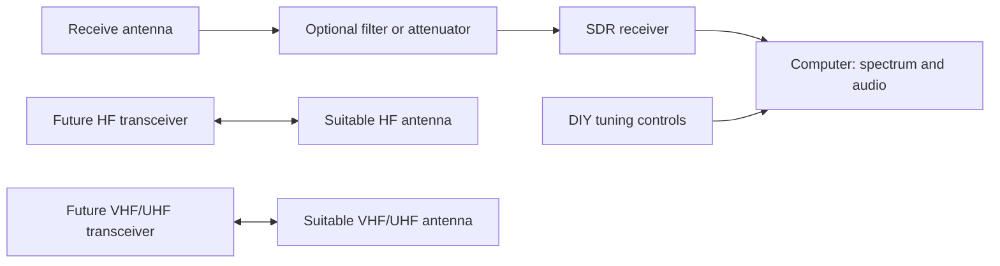

# Desktop Radio Lab

Build a desktop amateur radio station from zero, combining purchased equipment with antennas, electronics and software made at the workbench.

**Status:** project definition and build roadmap. No hardware has been purchased, assembled or tested as part of this project. Existing equipment and operator qualifications still need to be inventoried.

## Goal

Progress from the first locally received signal to documented amateur radio contacts using a station assembled and understood by its owner. Develop HF capability for distant contacts and VHF/UHF capability for local and regional operation. Each addition should solve a measured problem or enable a specific new capability.

Success means a reproducible station configuration, documented original builds, useful measurements and logged two way contacts, including a distant HF contact when conditions allow. Range depends on the antenna, location, noise, propagation and the other station. No distance or worldwide coverage is guaranteed.

Compare the [proposed objectives, from lunar and satellite experiments to practical local operation and first reception](docs/objectives.md) before selecting purchases. The recommended main target is an HF and VHF/UHF station with an intercontinental voice contact and validated original builds; the owner's final priorities are still open.

## Station concept

The receive and transmit paths are separate at first. An SDR receiver is not a transmitter. Frequency coverage does not imply simultaneous reception of every channel or support for every modulation. HF is the principal route toward distant contacts; VHF/UHF expands local and regional operation, including suitable amateur repeaters. See the [technical references](docs/sources.md).

Before adding a transmitter, design receiver protection and antenna switching. Never connect transmitter output directly to an SDR input. A shared antenna needs properly rated switching and isolation.

## Buy and build

| Part | Starting approach | Evidence to keep |
| --- | --- | --- |
| Receiver | Buy one SDR compatible with the selected first band and computer | Model, software versions, settings and first reception |
| Antenna | Build a simple antenna appropriate to available space and the first band | Dimensions, diagram, construction photos and comparison |
| Feed line and connectors | Buy suitable cable and connectors; assemble where practical | Cable type, length, continuity and losses when measured |
| Filters and attenuators | Build only after identifying an interference or overload problem | Circuit, parts and measured frequency response |
| Desk controls | Build a tuning knob and controls using a purchased microcontroller | Wiring, firmware and demonstrated integration |
| Transmit station | Select a commercial unit or documented kit after defining bands and authorization | Configuration, bench checks and contacts |
| Power and instruments | Buy suitable low voltage power equipment and obtain instruments as needed | Ratings, setup and measurement limitations |

Specific products and costs remain open. This is an architecture, not an order list. Start with a single receive chain; expand it after the first evidence is collected.

## Build process

Follow the [roadmap](docs/roadmap.md) and record each experiment in the [build log](docs/build-log.md). For every meaningful iteration:

1. Define the capability or problem.
2. Draw the circuit or connection diagram and list the necessary parts.
3. Assemble, configure and explain how it works.
4. Measure the result against a baseline and record limitations.
5. Publish the evidence in a small, coherent commit before choosing the next improvement.

Store schematics, firmware and measurements when they exist. Clearly label simulation, remote reception, local reception and measured hardware results. Remote web receivers can support learning but do not validate this station's antenna.

## First practical step

Record the initial budget, antenna space, equipment already available, soldering and electronics experience, and licensing status. Then select one band, one receiver and one feasible antenna. The first physical milestone is a repeatable reception through the station's own antenna.

## Operating context

The initial phase is receive only, focused on amateur and broadcast signals. Before amateur transmission in Italy, verify the operator's licence, callsign and general authorization with the [MIMIT](https://ispettorati.mise.gov.it/index.php/servizi/radioamatori/), together with the applicable bands and operating limits. Being able to tune a frequency does not authorize transmitting on it.
